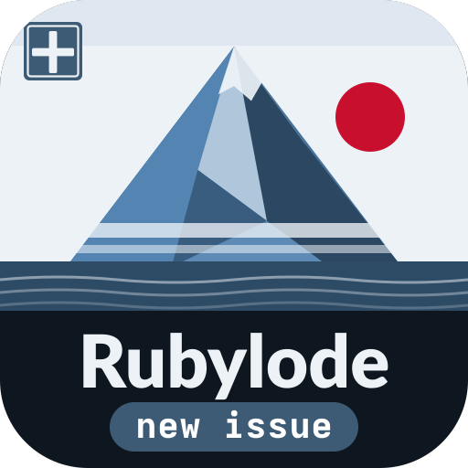
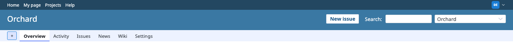
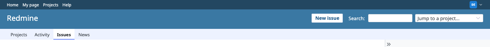

# Rubylode New issue button for Redmine

TL;DR: a New issue button in front of the search box on every [Redmine](https://www.redmine.org) page.

Contents:

- [What it does](#what-it-does)
- [Installation](#installation)
- [Compatibility](#compatibility)
- [Styling](#styling)
- [Details](#details)
- [Try it](#try-it)
- [Tests](#tests)
- [Releasing](#releasing)
- [License](#license)

Redmine lets you start a ticket only inside a project (the "+" menu). On the global issue list, My page, Activity and the
administration pages there is no way to. This plugin adds one button that works on every page.

Inside a project:

On any other page:

## What it does

- Inside a project the button opens that project's new issue form. Anywhere else it opens the global form, which asks
  for the project.
- The button shows for a signed-in user who may add issues, with the label in the user's language. Nobody else sees it.
- It sits as the first thing in the search box area, or first in the header on a page that has no search box.
- It works with any theme, and a theme can restyle it (see [Styling](#styling)).
- The phone layout hides it, because Redmine's own phone menu has the link.
- It needs no migration, setting, gem or JavaScript library.

## Installation

Redmine 7.x. The folder must be named `redmine_rubylode_new_issue_button`, the same as the plugin id.

1. Put the plugin in your Redmine's `plugins` folder:

       cd /path/to/redmine/plugins
       git clone https://github.com/rubylode/redmine-rubylode-new-issue-button.git redmine_rubylode_new_issue_button

   Or unpack a [release archive](https://github.com/rubylode/redmine-rubylode-new-issue-button/releases) there, as
   `redmine_rubylode_new_issue_button`.

2. Restart Redmine ([Passenger](https://www.phusionpassenger.com), [Puma](https://puma.io) or whatever serves it).

With [Docker](https://www.docker.com), mount or copy the plugin to
`/usr/src/redmine/plugins/redmine_rubylode_new_issue_button` and restart the container.

To upgrade, `git pull` and restart.

To remove it, delete the folder and restart. The plugin changes nothing in the database.

## Compatibility

Redmine 7.x. Tested on Redmine 7.0.2 and the 7.0 stable branch, with Ruby 3.4 and 4.0. Older Redmine versions are not supported.

## Styling

The button is one link, `a.rubylode-new-issue-button`, inside `#quick-search` (or directly inside `#header` on a page
without a search box). That is the only class the plugin adds.

The plugin's stylesheet makes a plain white button that suits Redmine's default theme. Every rule starts with `#header`,
because the header colours its links white and an unprefixed rule loses to that.

A theme overrides it with its own stylesheet. Redmine loads plugin stylesheets after the theme's, in alphabetical order,
so when two rules have the same specificity the plugin's wins. Put `body` in front to give the theme's rule more weight
than the plugin's `#header a.rubylode-new-issue-button`:

    body #header a.rubylode-new-issue-button {
      background: #d33f49;
      border-color: #d33f49;
      color: #fff;
    }
    body #header a.rubylode-new-issue-button:hover { background: #b6323b; color: #fff; }

Without `#header` and `body` the plugin's rule wins and your change seems to do nothing. Avoid `!important`. To hide the
button on a layout, set `display: none` the same way.

## Details

`lib/redmine_rubylode_new_issue_button/hooks.rb` adds the stylesheet to the page head and, at the end of the body, a
script tag that carries the address and the label as `data-href` and `data-label`.
`assets/javascripts/rubylode_new_issue_button.js` inserts the link as the first child of `#quick-search` (or of
`#header` when a page has no search box). The script sits after the header in the page, so the button shows up with the
first paint.

## Try it

A throwaway Redmine 7 runs from this folder, with the repository mounted as the plugin:

    ruby bin/demo up
    open http://localhost:3011

The first start loads made-up demo data: three private projects and three people. Sign in as `admin` / `admin`,
as `dana` (may add issues in Orchard and Lighthouse only) or as `sam` (may not add issues anywhere), both with the
password `demo-password-1`. `docker compose up -d` alone starts a bare Redmine. Stop the demo with `ruby bin/demo down`
and wipe it with `ruby bin/demo reset`.

With Node and Chrome installed, run `npm install` once, then `npm run check` tests the button in the running demo and
`npm run screenshots` retakes the pictures above.

## Tests

    bin/test                                              all integration tests
    bin/test test/integration/new_issue_button_test.rb    one file

They run in a Redmine 7 image with its test gems (`docker/test.Dockerfile`) and check the page a browser would get: the
form a member is sent to inside a project, the global form outside one, no button for a signed-out visitor, and the
assets in place.

Pull Requests are welcome!

## Releasing

Push a `vX.Y.Z` tag whose version matches `version` in `init.rb` and has an entry in `CHANGELOG.md`. CI runs the tests, builds `redmine_rubylode_new_issue_button-X.Y.Z.zip` and publishes the GitHub release with the changelog entry as its notes. To build a release for a tag that already exists, use Actions, release, Run workflow.

The text for the www.redmine.org listing, and how to read the result of Check for updates, is in [docs/redmine-org-listing.md](docs/redmine-org-listing.md).

## License

GNU General Public License, version 2 or (at your option) any later version, the same as Redmine. See `LICENSE`.

Copyright (C) 2026  Nick Gorbikoff

No warranty, as the GPL says. The plugin adds a script and a stylesheet to every page, so try it on a copy of your tracker before the real one.
